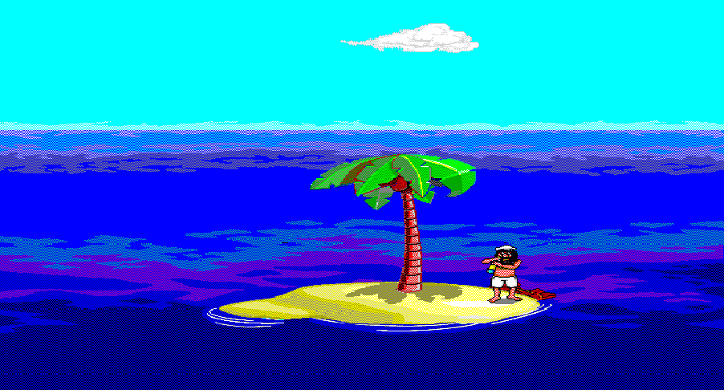
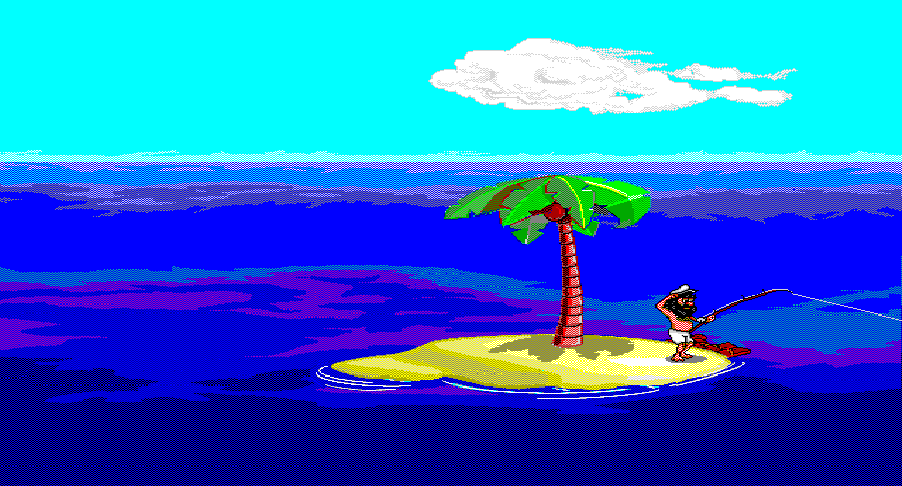
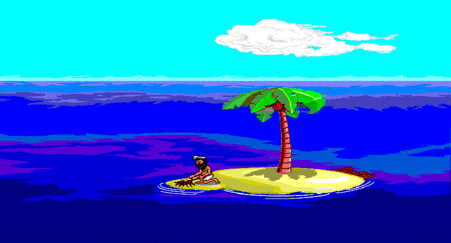
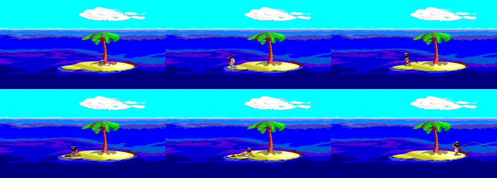

# Johnny Castaway — Static Recompilation



## What it is

Static recompilation of **Johnny Castaway** (Sierra / Dynamix, "Screen
Antics", 1992), the Windows 3.1 screen saver about a man stranded on a tiny
island, from its shipping 16-bit (NE) `SCRANTIC.SCR` to native C. The result
is a real 64-bit Windows screen saver, `johnny.scr`: Windows runs it
full screen, shows it in the screen saver settings' preview box, and opens its
settings dialog, as it would any modern saver. No emulator, no Windows 3.1.

The lifting, the Win16 host (KERNEL, USER, GDI, MMSYSTEM answered with Win32)
and the screen saver protocol are
[pcrecomp](https://github.com/sp00nznet/pcrecomp)'s. This is pcrecomp's first
Win16 screen saver. The project follows pcrecomp's house layout (setup script,
launcher, netlab recipe), like the [Space Bucks](https://github.com/sp00nznet/spacebucks-recomp)
recomp it took its layout from.

## Status: **v0.1.0. Johnny lives on his island: `/s`, `/p` and `/c` all work.**

| Stage | State |
|---|---|
| Version recompiled | Screen Antics: Johnny Castaway, 16 colour, v1.01 (Int. 1.4.93), the 1.44 MB floppy |
| Lift (`tools/relift.py`) | 4,158 functions, 0 unresolved calls, with pcrecomp's own code map (no IDA) |
| Toolkit | pcrecomp branch `pcrecomp-johnny` (on `pcrecomp-ne-spacebucks`; not yet in `main`) |
| `/s`: run full screen | **works**: the island, the sea, the clouds, and Johnny's scenes one after another (sleeping, walking, fishing, building a fire). Any key ends it. Scaled from 640x480 to the whole monitor |
| `/p <hwnd>`: preview | **works**: the same, drawn small inside the settings' preview box, silent, ended by Windows closing the box |
| `/c`: settings | **works**: the original dialog (start of day, background, password, sounds); OK saves to `SCRANTIC.INI` |
| Password protection | the original's own dialogs open (Change Password); asking for it on wake is not checked yet |
| Sound | plays (its WAVE resources through `sndPlaySound`) |
| Installing | `Setup.cmd -Install` copies it to `%LOCALAPPDATA%\Programs\JohnnyCastaway` and makes it your screen saver |
| Long runs (holidays, Mary, the visitors, night) | not checked: they come with days and months of running |
| Conformance harness | none yet ([ROADMAP.md](ROADMAP.md)); runs are checked by screenshot |

How it got here is [docs/bringup.md](docs/bringup.md).

## Screenshots

Real output of `build\johnny.scr`, recompiled code throughout:

| | |
|---|---|
|  |  |
|  |  |
|  |  |

## What is not in this repo

Nothing from the screen saver: no `.SCR`, no `RESOURCE.001`, no disk image,
and **no generated source**. The recompiled C is produced on your machine from
your own copy by `tools/relift.py`, into `work/`, which is gitignored. The tool
ships; its output never does.

## Getting Started

You need **your own copy of Screen Antics: Johnny Castaway**: the files from
its floppy (`SCRANTIC.SC$`, `RESOURCE.00$`, `RESOURCE.MAP`), or an installed
copy (`SCRANTIC.SCR`, `RESOURCE.001`, `RESOURCE.MAP`). Nothing is downloaded for
you.

### Quick start: Setup.cmd

1. Download this repository and unzip it somewhere with 150 MB free.
2. Double-click **`Setup.cmd`**, or run `Setup.cmd -GameDir <folder with the files>`.

It checks for Python 3.10+, the `capstone` package, CMake, Ninja and MSYS2's
MinGW-w64 gcc, and **asks** before installing any of them. It checks for the
pcrecomp toolkit beside this folder on branch `pcrecomp-johnny` (it offers to
clone it). Then it unpacks the floppy's files into `game\` (the installer's
compression is PKWARE DCL; `tools\kd_expand.py` reads it), lifts, builds
`build\johnny.scr`, and leaves `Johnny Castaway.cmd`, which runs it full
screen.

`Setup.cmd -Install` also installs it as your screen saver: it copies
`johnny.scr`, `mem_image.bin` and `game\` to
`%LOCALAPPDATA%\Programs\JohnnyCastaway` and points
`HKCU\Control Panel\Desktop\SCRNSAVE.EXE` at it. Windows' screen saver settings
then show it (as "johnny") with its preview and its Settings button.

### Step by step

```
git clone -b pcrecomp-johnny https://github.com/sp00nznet/pcrecomp ..\pcrecomp
python tools\kd_expand.py <floppy folder> game        & rem or copy an installed copy's files
copy <floppy folder>\RESOURCE.MAP game\
python tools\relift.py
cmake -S . -B build -G Ninja -DCMAKE_C_COMPILER=C:/msys64/mingw64/bin/gcc.exe
cmake --build build
build\johnny.scr /s
```

`build\johnny.exe` is the same program as a console build, for logs.

### Running it

| Command | What it does |
|---|---|
| `johnny.scr /s` | full screen; any key or mouse movement ends it |
| `johnny.scr /p <hwnd>` | draws inside the window `<hwnd>` until that window closes |
| `johnny.scr /c` (or no arguments) | the settings dialog |

Set `PCRECOMP_MUTE=1` for silence. `tools\hiddenrun.py` runs any of these on a
private desktop and screenshots it (how every picture here was taken):
`python tools\hiddenrun.py --secs 30 --shot 20 --out out\run -- build\johnny.scr /s`,
and `--preview 304x224 ... /p {hwnd}` for a preview.

## How the screen saver works

Windows 3.1's `SCRNSAVE.LIB`, linked into `SCRANTIC.SCR`, knows one switch:
`/s` runs, anything else configures. Windows 95 and later call a saver with
`/s`, `/p <hwnd>` and `/c[:<hwnd>]`. pcrecomp's host
(`runtime/win16/host/screensaver.c`) translates: `/s` and `/p` hand the guest
`/s`, `/c` hands it `/c`. The guest still believes the screen is 640x480; its
window is really the monitor or the preview box, and every DC on it scales the
guest's drawing to fit. The guest's own code ends the saver on a key or mouse
movement, as it always did; in a preview those messages are held back, so
hovering over the settings does not end it, and Windows ends it by closing the
box.

## Credits and license

The code in this repo is MIT ([LICENSE](LICENSE)); third-party notes are in
[NOTICE](NOTICE). Johnny Castaway / Screen Antics is (c) 1992 Sierra On-Line /
Dynamix. Not affiliated with or endorsed by them.
