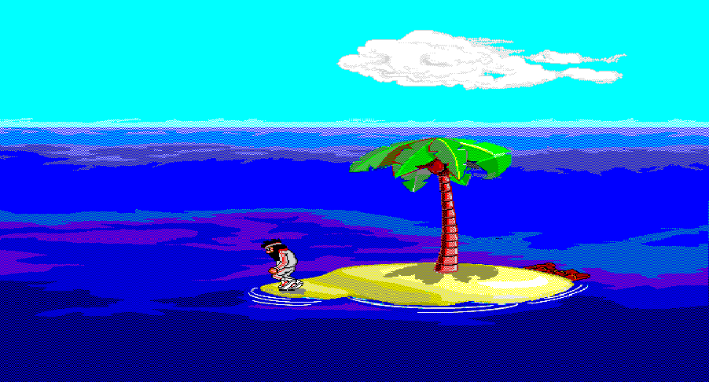
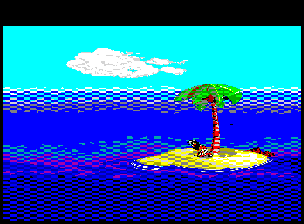
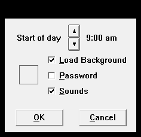

# Johnny Castaway — Static Recompilation

Static recompilation of **Johnny Castaway** (Sierra / Dynamix, "Screen
Antics", 1992), the Windows 3.1 screen saver about a man stranded on a tiny
island, from its shipping 16-bit (NE) `SCRANTIC.SCR` to native C. The result
is a real 64-bit Windows screen saver, `johnny.scr`: Windows runs it full
screen, shows it in the screen saver settings' preview box and opens its
settings dialog, as it would any modern saver. No emulator, no Windows 3.1.

Built on the [pcrecomp](https://github.com/sp00nznet/pcrecomp) toolchain, on
its branch **`pcrecomp-johnny`** (on `pcrecomp-ne-spacebucks`, not yet in
`main`): the lifting, the Win16 host (KERNEL, USER, GDI, MMSYSTEM answered
with Win32) and the screen saver protocol are pcrecomp's. It is pcrecomp's
first Win16 screen saver, in the layout of the
[Space Bucks](https://github.com/sp00nznet/spacebucks-recomp) recomp.

## Getting Started

You need **your own copy of Screen Antics: Johnny Castaway**: the files from
its floppy (`SCRANTIC.SC$`, `RESOURCE.00$`, `RESOURCE.MAP`), or an installed
copy (`SCRANTIC.SCR`, `RESOURCE.001`, `RESOURCE.MAP`). Nothing from it is in
this repository or downloaded for you; everything is built on your machine
from your copy. There is no installer release yet.

### The setup script

1. Download this repository (the green **Code** button, then **Download ZIP**)
   and unzip it somewhere with 150 MB free.
2. Windows: double-click **`Setup.cmd`**, or run
   `Setup.cmd -GameDir <folder with the files>`.
3. Run it with **`Johnny Castaway.cmd`** in that folder (full screen; any key
   ends it), or install it as your screen saver with **`Setup.cmd -Install`**.

The script asks before installing anything (Python 3.10+ with `capstone`,
CMake, Ninja, MSYS2's MinGW-w64 gcc), fetches pcrecomp on branch
`pcrecomp-johnny` beside this folder if it is missing, unpacks the floppy's
compressed files into `game\`, lifts and builds `build\johnny.scr`. A rerun
skips finished steps; if it stops, it says why in one sentence and the
details are in `setup.log`. `-Install` copies it to
`%LOCALAPPDATA%\Programs\JohnnyCastaway` and makes it your screen saver;
Windows' settings then show it (as "johnny") with its preview and its
Settings button. Building by hand is in **[docs/building.md](docs/building.md)**.

Linux and macOS: not yet. The host is a Win32 program built with MinGW, and
`./setup.sh` says so and exits.

## Status

**v0.1.0: Johnny lives on his island. `/s`, `/p` and `/c` all work.**

| Stage | State |
|---|---|
| Version recompiled | Screen Antics: Johnny Castaway, 16 color, v1.01 (Int. 1.4.93), the 1.44 MB floppy |
| Lift (`tools/relift.py`) | 4,158 functions, 0 unresolved calls, with pcrecomp's own code map (no IDA) |
| `/s`: full screen | works: the island, the sea, the clouds and Johnny's scenes one after another (sleeping, walking, fishing, building a fire), scaled from 640x480 to the monitor |
| `/p <hwnd>`: preview | works: the same, small, inside the settings' preview box, silent |
| `/c`: settings | works: the original dialog; OK saves to `SCRANTIC.INI` |
| Password protection | the original's own dialogs open; asking for it on wake is not checked yet |
| Sound | plays (its WAVE resources through `sndPlaySound`) |
| Long runs (holidays, Mary, the visitors, night) | not checked: they come with days and months of running |
| Conformance harness | none yet; runs are checked by screenshot ([docs/testing.md](docs/testing.md)) |

[docs/bringup.md](docs/bringup.md) is the log of each wall and its fix, and
[ROADMAP.md](ROADMAP.md) what comes next.

## Screenshots

Real output of `build\johnny.scr`, recompiled code throughout, taken on a
private desktop with `tools\hiddenrun.py`:

| | |
|---|---|
|  |  |
|  |  |
|  |  |

## Documentation

- [docs/building.md](docs/building.md): building by hand, the floppy's compression, installing
- [docs/testing.md](docs/testing.md): the switches, and runs on a private desktop
- [docs/screensaver.md](docs/screensaver.md): how a 1992 saver answers Windows 10's `/s`, `/p` and `/c`
- [docs/bringup.md](docs/bringup.md): every wall so far and its fix
- [ROADMAP.md](ROADMAP.md), [CHANGELOG.md](CHANGELOG.md), [CONTRIBUTING.md](CONTRIBUTING.md)

## Contributors

See **[CONTRIBUTORS.md](CONTRIBUTORS.md)** for who did what.

## License

MIT for this repository's own code ([LICENSE](LICENSE)); `tools/kd_expand.py`'s
decoder follows zlib's `blast.c` ([NOTICE.md](NOTICE.md)). Johnny Castaway /
Screen Antics is © 1992 Sierra On-Line / Dynamix; none of its files, and
nothing generated from them, is in this repository.
